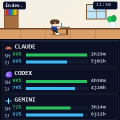

<div align="center">

# 🖥️ Mini Screen Companion

**Affichage en temps réel des quotas d'IA (Claude Code, OpenAI Codex, Google Antigravity) sur mini-écrans de bureau (GeekMagic, SmallTV, ESP8266/ESP32).**

[](https://www.python.org/downloads/)
[](https://opensource.org/licenses/MIT)
[]()

<br/>



<p align="center">
  <b>Ne soyez plus jamais coupé en plein dev par les limites de requêtes IA.</b><br/>
  Consultez vos quotas restants de session (5h) et hebdomadaires (7j) d'un coup d'œil sur votre bureau.
</p>

[English](README.md) • [Fonctionnalités](#fonctionnalités) • [Démarrage Rapide](#démarrage-rapide) • [Architecture](#architecture) • [Configuration](#configuration)

</div>

---

## ✨ Fonctionnalités

- **🎯 Suivi Multi-Fournisseurs en direct** :
  - **Claude Code** (Anthropic) — Quota session 5h et plafond hebdomadaire 7 jours.
  - **OpenAI Codex** — Session glissante 5h et quota hebdomadaire.
  - **Google Gemini / Antigravity** — Suivi session et volume global.
- **⚡ Zéro Configuration pour l'utilisateur** :
  - Détection automatique des chemins sous Windows (`%APPDATA%`), macOS et Linux.
  - Gestion automatique du processus en arrière-plan sans doublons (`.companion.lock`).
- **🛡️ Conçu selon 3 principes stricts** :
  - **Générique** : Multi-plateforme (Windows, Mac, Linux), repli de polices automatique et découverte d'écran sur le réseau local.
  - **Immuable** : Modèles de données figés (`@dataclass(frozen=True)`). Moteur de rendu graphique 100% pur et déterministe.
  - **Idempotent** : Calcul d'empreinte SHA-256 évitant les écritures inutiles sur la mémoire flash du microcontrôleur quand le quota n'a pas bougé.
- **📟 Matériel Compatible** :
  - GeekMagic Smart Weather Clock (horloges météo AliExpress avec ESP8266).
  - GeekMagic SmallTV & SmallTV-Pro.
  - N'importe quel écran affichant des images par requête HTTP (ESP8266/ESP32).
  - Écran virtuel local (génération de fichier `.jpg` pour Home Assistant ou tests).

---

## 🚀 Démarrage Rapide

### 1. Windows (En 1 clic)
Double-cliquez sur `start.bat`. Le script va automatiquement :
1. Vérifier Python et créer l'environnement virtuel `.venv`.
2. Installer les dépendances (`pillow`, `requests`).
3. Créer le fichier `config.json` avec votre adresse IP locale.
4. Tester l'envoi d'une image et démarrer la synchronisation.

### 2. macOS / Linux
```bash
git clone https://github.com/TechSentinel-fr/mini-screen-companion.git
cd mini-screen-companion
chmod +x start.sh && ./start.sh
```

---

## 🛠️ Commandes en Ligne de Commande (CLI)

```bash
# Envoyer une seule mise à jour et quitter (idéal pour un script ou cron)
python -m mini_screen_companion once

# Scanner votre réseau Wi-Fi pour trouver l'adresse IP de votre écran GeekMagic
python -m mini_screen_companion discover

# Générer un aperçu local sans écran physique
python -m mini_screen_companion preview --open

# Tester avec des données de démonstration réalistes
python -m mini_screen_companion once --demo

# Vérifier le statut du service d'arrière-plan
python -m mini_screen_companion status

# Arrêter le service d'arrière-plan
python -m mini_screen_companion stop
```

---

## ⚙️ Configuration (`config.json`)

```json
{
  "screen": {
    "type": "geekmagic",
    "host": "192.168.1.4",
    "port": 80,
    "timeout": 8,
    "brightness": 85
  },
  "display": {
    "mode": "cozy",
    "carousel_page_duration_seconds": 10
  },
  "avatar": {
    "name": "",
    "status": "auto",
    "action": "auto",
    "animated": true,
    "fps": 8,
    "metric": "remaining"
  },
  "polling": {
    "refresh_interval_seconds": 15
  }
}
```

### Modes d'affichage
- `"cozy"` *(Par défaut)* : Ratio 1/3 scène illustrée rétro pixel art animée + 2/3 HUD haute lisibilité des quotas (Claude, Codex, Gemini simultanés).
- `"summary"` : Les 3 fournisseurs affichés simultanément avec double jauge (`5H` & `7J`) et décomptes de réinitialisation.
- `"carousel"` : Alterne automatiquement toutes les 10 secondes entre la vue d'ensemble et des jauges géantes pour chaque fournisseur.
- `"claude"` / `"codex"` / `"gemini"` : Vue plein écran dédiée au fournisseur choisi.

### Animations d'avatar (`avatar.action`)
- `"auto"` : Mode Tamagotchi vivant — réagit aux sessions de dev en direct (Code Turbo, pause café, câlin chat, jogging, dodo nuit).
- `"desk"` : Développeur au bureau avec ordi portable lumineux et café fumant.
- `"coffee"` : Pause café près de la fenêtre avec vapeur animée.
- `"pet"` : Câlin avec le chat roux qui ronronne et remue la queue.
- `"run"` : Course dynamique à travers la pièce.
- `"sleep"` : Avatar endormi sur son tapis avec « z Z z ».
- **Avatar personnalisé** : Glissez votre propre GIF animé ou séquence PNG dans `assets/avatar/custom.gif` pour l'animer automatiquement dans la scène !

---

## 🧪 Tests Unitaires

La suite de tests ne nécessite aucun module tiers :

```bash
python -m unittest discover tests/
```

---

## 📄 Licence

Licence MIT — Copyright (c) 2026 TechSentinel.
Totalement libre d'utilisation, modification et redistribution.
