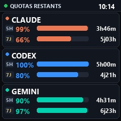

<div align="center">

# 🖥️ Mini Screen Companion

**Live AI coding quota monitor for mini desktop smart displays (GeekMagic, SmallTV, ESP8266/ESP32).**

[](https://www.python.org/downloads/)
[](https://opensource.org/licenses/MIT)
[]()
[]()

<br/>



<p align="center">
  <b>Never get blindsided by AI rate limits during intense coding sessions again.</b><br/>
  Real-time remaining session quota (5h) + weekly quota (7d) on your desk at a glance.
</p>

[Français](README.fr.md) • [Features](#features) • [Quick Start](#quick-start) • [Architecture](#architecture) • [Configuration](#configuration)

</div>

---

## ✨ Features

- **🎯 Multi-Provider Live Quotas**:
  - **Claude Code** (Anthropic) — 5H session quota & 7-day weekly limit.
  - **OpenAI Codex** — 5H sliding session & weekly ceiling.
  - **Google Gemini / Antigravity** — Session & monthly/weekly quotas.
- **⚡ Zero Configuration for End-Users**:
  - Automatically locates local CLI auth tokens & monitor caches (`%APPDATA%`, `~/.config`, `~/Library`).
  - Self-healing background service with single-instance lock (`.companion.lock`).
- **🛡️ Built on 3 Core Principles**:
  - **Generic**: Works across Windows, macOS, Linux, with automatic font resolution and screen auto-discovery.
  - **Immutable**: Pure functional data models (`@dataclass(frozen=True)`). Deterministic pixel-perfect rendering.
  - **Idempotent**: SHA-256 frame hashing avoids redundant Wi-Fi transfers and preserves ESP flash memory.
- **📟 Hardware Compatibility**:
  - GeekMagic Smart Weather Clock (AliExpress clone).
  - GeekMagic SmallTV & SmallTV-Pro.
  - Any HTTP Photo Display / ESP8266 / ESP32.
  - Local virtual display (outputs `.jpg` or `.png` for Home Assistant / OBS / testing).

---

## 🚀 Quick Start

### 1. Windows (One-Click)
Double-click `start.bat`. It will automatically:
1. Verify Python & create a virtual environment `.venv`.
2. Install dependencies (`pillow`, `requests`).
3. Generate `config.json` with your screen's local IP.
4. Test transmission and launch background monitoring.

### 2. macOS / Linux
```bash
git clone https://github.com/TechSentinel-fr/mini-screen-companion.git
cd mini-screen-companion
chmod +x start.sh && ./start.sh
```

---

## 🛠️ Command-Line Interface (CLI)

```bash
# Push single frame and exit (ideal for cron or test)
python -m mini_screen_companion once

# Scan your Wi-Fi network to find your GeekMagic screen's IP
python -m mini_screen_companion discover

# Generate local preview image without a physical screen
python -m mini_screen_companion preview --open

# Test with realistic demo data (no active CLI session needed)
python -m mini_screen_companion once --demo

# Check background daemon status
python -m mini_screen_companion status

# Stop background daemon
python -m mini_screen_companion stop
```

---

## ⚙️ Configuration (`config.json`)

```json
{
  "screen": {
    "type": "geekmagic",
    "host": "192.168.1.4",
    "port": 80,
    "timeout": 8,
    "brightness": 85
  },
  "display": {
    "mode": "summary",
    "carousel_page_duration_seconds": 10
  },
  "polling": {
    "refresh_interval_seconds": 60
  }
}
```

### Display Modes
- `"summary"` *(Default)*: All 3 providers displayed simultaneously with dual gauges (`5H` & `7J`) and reset countdowns.
- `"carousel"`: Automatically cycles between the summary view and full-screen giant gauges for each provider every 10 seconds.
- `"claude"` / `"codex"` / `"gemini"`: Dedicated full-screen view for your preferred provider.

---

## 🏗️ Architecture

```
mini-screen-companion/
├── src/mini_screen_companion/
│   ├── core/
│   │   ├── models.py       # Immutable frozen dataclasses (QuotaWindow, Snapshot)
│   │   ├── config.py       # Validated config with env overrides
│   │   ├── paths.py        # Cross-platform cache & token resolver
│   │   ├── lock.py         # Idempotent process lock
│   │   └── fonts.py        # Cross-platform typography hierarchy
│   ├── collectors/
│   │   ├── plugin_cache.py # Reads live local usage cache (ClaudeCodeUsageMonitor)
│   │   └── mock.py         # Realistic demo data generator
│   ├── renderers/
│   │   ├── theme.py        # High-contrast palette & gauge thresholds
│   │   ├── summary.py      # Micro-display 240x240 dual-gauge renderer
│   │   └── detail.py       # Full-screen single provider renderer
│   └── screens/
│       ├── geekmagic.py    # GeekMagic ESP8266 client with SHA-256 cache
│       └── local_file.py   # Virtual screen target for local testing
```

---

## 🧪 Testing

The test suite runs with zero third-party testing dependencies:

```bash
python -m unittest discover tests/
```

---

## 📄 License

MIT License — Copyright (c) 2026 TechSentinel.
Feel free to fork, customize, and share!
