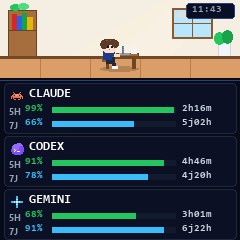

<div align="center">

# 🎮 Mini Screen Companion

### Autonomous Pixel Art Dev Tamagotchi & Live AI Coding Quota Monitor

**Real-time monitoring for Claude Code, OpenAI Codex & Google Gemini on GeekMagic, SmallTV & ESP8266/ESP32 desktop displays.**

<br/>

[](https://www.python.org/)
[](https://opensource.org/licenses/MIT)
[]()
[]()

<br/>



<p align="center">
  <b>Never get blindsided by AI rate limits during intense coding sessions again.</b><br/>
  1/3 cozy living chibi dev pixel art room &bull; 2/3 high-contrast dual-gauge quota HUD.
</p>

[🇫🇷 Version Française](README.fr.md) • [✨ Features](#-features) • [🚀 Quick Start](#-quick-start) • [⚙️ Configuration](#️-configuration) • [🛠️ CLI](#️-command-line-interface-cli) • [🏗️ Architecture](#️-architecture)

</div>

---

## ✨ Features

- **🎮 1/3 Living Dev Tamagotchi (Top 80px)**:
  - **Dynamic State Machine**: Reacts autonomously to real coding activity, time of day, and idle rhythms.
  - **Living Poses**:
    - 💻 **Active Coding**: Furious typing on a glowing laptop with code syntax glints & steaming coffee mug.
    - ☕ **Coffee Break**: Sipping coffee by the sunlight window with animated steam.
    - 🐱 **Cat Cuddles**: Sitting on the wooden floor petting an orange tabby cat with swaying tail.
    - 🏃 **Morning / Evening Jog**: Jogging across the room with animated bounce.
    - 🌙 **Night Sleep**: Curled up under a cozy blanket on a soft rug with floating *"z Z z"*.
  - **Atmospheric Day & Night Lighting**: Dynamic blue sky with sunlight rays vs dark starry night with crescent moon.
  - **Fair Chibi Anime Style**: Expressive eyes with specular glint, cute blush, and fluffy brown hair.
  - **Custom Avatar Support**: Drop your own 240x80 GIF or PNG frames into `assets/avatar/custom.gif` to animate any custom sprite.

- **📊 2/3 Crystal-Clear Quota HUD (Bottom 160px)**:
  - **Claude Code** (Anthropic) &bull; **OpenAI Codex** &bull; **Google Gemini** displayed simultaneously.
  - **Dual Gauges per Provider**:
    - **5H Session Quota**: Real-time percentage bar with exact countdown timer to next reset (e.g., `2h40m`).
    - **7D Weekly Quota**: Weekly allowance bar with remaining days/hours (e.g., `5j02h`).
  - **Retro 8-bit Icons**: Coral space invader (Claude), purple terminal cloud (Codex), and cyan sparkle star (Gemini).
  - **Dynamic Color Grading**: Emerald green (>25%), amber warning (10–25%), and alert red (<10%).

- **⚡ Zero Setup for End-Users**:
  - Automatically parses local token caches & auth sessions on Windows (`%APPDATA%`), macOS (`~/Library`), and Linux (`~/.config`).
  - Single-instance background process management with PID lockfile (`.companion.lock`).
  - Subnet discovery tool scans your local Wi-Fi to auto-detect GeekMagic screens.

- **🛡️ Built for Microcontrollers**:
  - **Idempotent**: SHA-256 frame hashing avoids redundant Wi-Fi transfers and flash wear on the ESP8266/ESP32.
  - **Immutable Functional Core**: Pure `@dataclass(frozen=True)` data pipelines.
  - **Low Memory Footprint**: Auto-optimizes JPEG/GIF payloads to prevent ESP8266 socket exhaustion.

---

## 📟 Supported Hardware

| Hardware | Description | Connection |
|:---|:---|:---|
| **GeekMagic Smart Weather Clock** | 240x240 ESP8266 desktop clock (AliExpress) | Wi-Fi (HTTP Photo mode) |
| **GeekMagic SmallTV / SmallTV-Pro** | 240x240 ESP8266 / ESP32 smart display | Wi-Fi (HTTP) |
| **ESP8266 / ESP32 TFT DIY** | Custom microcontrollers running web photo frames | Wi-Fi (HTTP POST) |
| **Virtual Local Display** | Renders static JPG + animated GIF locally | Home Assistant / OBS / Web |

---

## 🚀 Quick Start

### 1. Windows (One-Click)

Double-click `start.bat`. It will automatically:
1. Verify Python & setup the `.venv` virtual environment.
2. Install required dependencies (`pillow`, `requests`).
3. Generate `config.json` with your screen's IP address.
4. Upload an initial frame and start the background monitoring loop.

```powershell
git clone https://github.com/neosoda/MiniScreenCompanion.git
cd MiniScreenCompanion
.\start.bat
```

### 2. macOS & Linux

```bash
git clone https://github.com/neosoda/MiniScreenCompanion.git
cd MiniScreenCompanion
chmod +x start.sh && ./start.sh
```

---

## 🛠️ Command-Line Interface (CLI)

```bash
# Set PYTHONPATH for direct module execution
export PYTHONPATH="src"    # Linux / macOS
$env:PYTHONPATH="src"      # Windows PowerShell

# Push single frame and exit (ideal for cron or test)
python -m mini_screen_companion once

# Start the continuous background monitoring daemon
python -m mini_screen_companion run

# Scan local Wi-Fi network to find GeekMagic screen IP
python -m mini_screen_companion discover

# Generate local preview (saves preview.gif & preview.jpg)
python -m mini_screen_companion preview --open

# Check running background daemon status
python -m mini_screen_companion status

# Stop background daemon
python -m mini_screen_companion stop

# Run with realistic mock data (no credentials needed)
python -m mini_screen_companion once --demo
```

---

## ⚙️ Configuration (`config.json`)

```json
{
  "screen": {
    "type": "geekmagic",
    "host": "192.168.1.4",
    "port": 80,
    "timeout": 10,
    "brightness": 85
  },
  "display": {
    "mode": "cozy",
    "carousel_page_duration_seconds": 10
  },
  "avatar": {
    "name": "",
    "status": "auto",
    "action": "auto",
    "animated": true,
    "fps": 8,
    "metric": "remaining"
  },
  "polling": {
    "refresh_interval_seconds": 15,
    "retry_delay_seconds": 10
  },
  "providers": {
    "claude": { "enabled": true },
    "codex": { "enabled": true },
    "antigravity": { "enabled": true }
  }
}
```

### Display Modes (`display.mode`)
- `"cozy"` *(Default)*: 1/3 top retro pixel art living scene + 2/3 high-contrast quota HUD for Claude, Codex, and Gemini.
- `"summary"`: Pure quota summary with 3 stacked cards and double 5H/7D gauges.
- `"carousel"`: Alternates every 10 seconds between summary overview and large single-provider gauges.
- `"claude"` / `"codex"` / `"gemini"`: Dedicated full-screen view for a single provider.

### Avatar Actions (`avatar.action`)
- `"auto"` *(Default)*: Autonomous Tamagotchi mode — reacts to coding sessions, time of day, and idle breaks.
- `"desk"`: Sitting at wooden desk typing on laptop with code syntax glow and steaming mug.
- `"coffee"`: Relaxing coffee break standing near the window.
- `"pet"`: Sitting on floor petting orange tabby cat.
- `"run"`: Jogging across the room.
- `"sleep"`: Sleeping on cozy rug under blanket with floating *z Z z*.

---

## 🏗️ Architecture

```
MiniScreenCompanion/
├── src/mini_screen_companion/
│   ├── core/
│   │   ├── models.py       # Immutable frozen dataclasses (QuotaWindow, ProviderQuota, Snapshot)
│   │   ├── tamagotchi.py   # Autonomous state machine (coding, coffee, cat, jog, sleep)
│   │   ├── config.py       # Type-safe configuration with defaults
│   │   ├── paths.py        # Cross-platform cache & token resolver
│   │   ├── lock.py         # OS-level single instance process lock
│   │   └── fonts.py        # Cross-platform font resolver with retro fallbacks
│   ├── collectors/
│   │   ├── base.py         # Abstract base collector interface
│   │   ├── plugin_cache.py # Parser for Claude Code, Codex & Gemini session tokens
│   │   └── mock.py         # Deterministic mock collector for testing
│   ├── renderers/
│   │   ├── cozy_avatar.py  # 1/3 - 2/3 composite renderer with dual gauges
│   │   ├── avatar_sprites.py # 16-bit procedural pixel art sprites & room background
│   │   ├── pixel_icons.py  # 8-bit RGBA icons for AI providers
│   │   ├── summary.py      # Standard multi-card quota view
│   │   └── detail.py       # Full-screen single provider view
│   └── screens/
│       ├── base.py         # Abstract screen transport interface
│       ├── geekmagic.py    # Idempotent client for GeekMagic & ESP8266/ESP32
│       └── local_file.py   # File-based transport for static JPG & animated GIF
├── assets/                 # Default previews, fonts, and custom avatar assets
├── tests/                  # Zero-dependency test suite (13 passing tests)
├── start.bat               # Windows 1-click launcher
├── start.sh                # Unix launcher
└── config.example.json     # Documented default configuration
```

---

## 🧪 Tests

The project includes a complete test suite with **zero external dependencies**:

```bash
$env:PYTHONPATH="src"; python -c "
import tests.test_models as tm, tests.test_collectors as tc, tests.test_renderers as tr, tests.test_cozy_avatar as tca
for m in [tm, tc, tr, tca]:
    for n in dir(m):
        if n.startswith('test_'): getattr(m, n)(); print('PASS:', n)
print('ALL TESTS PASSED!')
"
```

---

## 📄 License

Distributed under the **MIT License**. See `LICENSE` for details.  
Copyright &copy; 2026 [neosoda](https://github.com/neosoda).


## 🚧 Living Companion 2.0 — Foundation

- Time-based pet behaviors (not coupled to network refresh loops).
- Independent animated cat, day/night lighting and eight-frame local GIF preview.
- Unavailable quotas are not silently replaced by fake numbers; `--demo` remains explicit.
- Factory GeekMagic HTTP: **static JPEG only until native animation is proven**. Default photo-write pacing: 300 seconds via `screen.min_upload_interval_seconds`.
- Secondary factory photo slots are no longer overwritten.

See [V2 implementation notes](docs/LIVING_COMPANION_V2.md).
