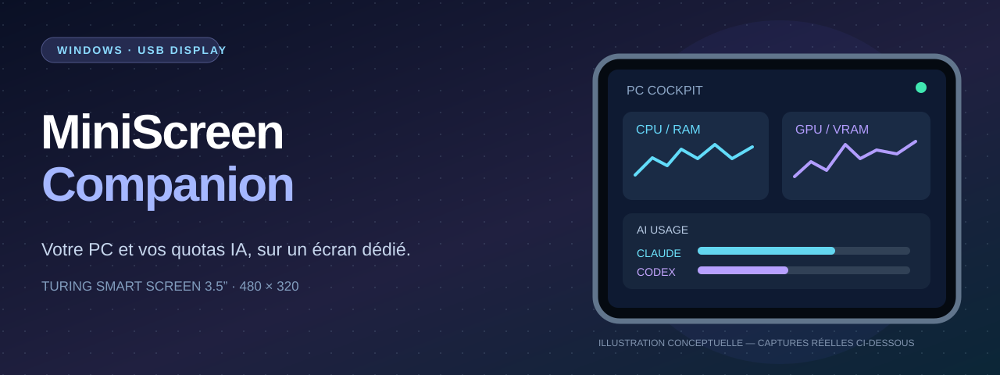
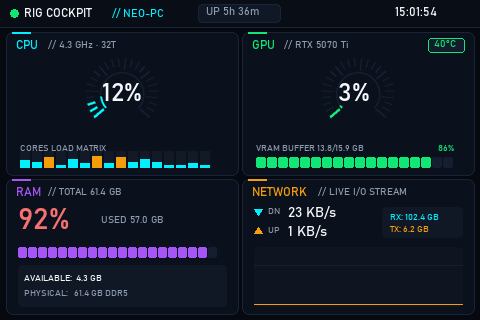
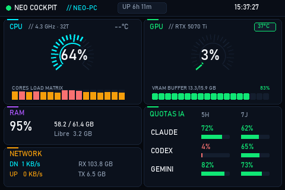

<p align="center"></p>

# 🚀 Turing 3.5" Cockpit Companion

Cockpit de télémétrie PC et de quotas IA en temps réel pour écran **Turing Smart Screen 3.5" IPS** (USB Type-C, révision Rev A / CH552T `USB35INCHIPSV2`).

<p align="center"><a href="#-utilisation-rapide"><strong>Démarrer</strong></a> · <a href="#️-configuration-configjson">Configurer</a> · <a href="#-tests">Tests</a></p>

<table><tr><td width="50%"></td><td width="50%"></td></tr><tr><td align="center"><sub>Monitoring CPU, GPU, mémoire et réseau</sub></td><td align="center"><sub>Suivi des quotas Claude Code, Codex et Gemini</sub></td></tr></table>

<sub>Les deux images ci-dessus sont des captures du projet. La bannière est illustrative.</sub>

---

## ⚡ Caractéristiques & Architecture

Une solution Windows dédiée aux écrans **Turing Smart Screen 3.5 pouces Rev A / CH552T**. Cette compatibilité matérielle ne signifie pas une prise en charge universelle des autres petits écrans USB.

- **Rendu Fluide Micro-Blit (3.5+ FPS)** :
  - Détection différentielle intelligente par quadrant (*dirty rectangles*).
  - Seules les zones en mouvement (aiguilles, pourcentages, graphiques) sont transmises au contrôleur série USB CDC (~70 ms par zone au lieu de 1 810 ms en plein écran).
  - Resynchronisation plein écran automatique configurable (par défaut toutes les 60 s).
- **Zéro Clignotement GPU (NVML Natif)** :
  - Interrogation directe de `nvml.dll` via C-types (< 0.1 ms).
  - Aucune commande shell `nvidia-smi` en sous-processus.
  - **Fini les micro-saccades et clignotements d'écrans PC / G-Sync.**
- **Température CPU en Temps Réel** :
  - Lecture des sondes matérielles (Tctl/Tdie pour AMD Ryzen, Package pour Intel) via `LibreHardwareMonitorLib.dll`.
  - Service Windows autonome en arrière-plan sans impact de charge.
- **Monitoring des Quotas IA** :
  - Lecture non-bloquante du cache local `ClaudeCodeUsageMonitor`.
  - Suivi en direct des quotas **Claude Code**, **OpenAI Codex** et **Google Gemini / Antigravity** (fenêtres 5H et plafonds 7J).
- **Processus Indépendant & Persistant** :
  - Exécution en arrière-plan détachée (`pythonw.exe`).
  - Fermer votre IDE, votre terminal ou Antigravity n'interrompt pas l'écran.
  - Verrouillage matériel par Mutex Windows : une seule instance accède au port COM.

---

## 🖥️ Organisation de l'Affichage (Cockpit 480×320)

```
+-----------------------------------------------------------------------+
|  [● LIVE] NEO COCKPIT // HOSTNAME         [UP 4h 12m]        15:42:00 |
+-----------------------------------+-----------------------------------+
| CPU // 4.5 GHz · 32T       82°C   | GPU // RTX 5070 Ti         38°C   |
|         [ Tachymètre % ]          |         [ Tachymètre % ]          |
|  CORES LOAD MATRIX (16 barres)    |  VRAM: 4.8 / 16.0 GB      42W     |
+-----------------------------------+-----------------------------------+
| RAM                    NETWORK    | QUOTAS IA         5H          7J  |
| 75%  24.1 / 31.9 GB    DN 12.4 MB | CLAUDE           65%         61%  |
| Libre 7.8 GB           UP  1.2 MB | CODEX             0%         64%  |
| RX 4.2 GB   TX 1.1 GB             | GEMINI           81%         73%  |
+-----------------------------------+-----------------------------------+
```

---

## 🛠️ Utilisation Rapide

### 1. Démarrer en arrière-plan (Recommandé)
Double-cliquez sur :
👉 [start_background.bat](start_background.bat)
*(Lance le cockpit de manière totalement invisible et autonome)*

### 2. Vérifier l'état et les performances
Double-cliquez sur :
👉 [status.bat](status.bat)
*(Affiche le PID actif, la mémoire vive consommée et les derniers logs avec le FPS effectif)*

### 3. Arrêter proprement
Double-cliquez sur :
👉 [stop.bat](stop.bat)
*(Affiche l'écran Standby sur le Turing 3.5 et libère le port COM)*

### 4. Pivoter l'écran (0° / 180°)
Double-cliquez sur :
👉 [flip_orientation.bat](flip_orientation.bat)
*(Bascule instantanément l'affichage selon le sens de branchement de votre câble USB-C)*

### 5. Démarrage automatique avec Windows
- **Activer** : Double-cliquez sur [install_startup.bat](install_startup.bat).
- **Désactiver** : Double-cliquez sur [uninstall_startup.bat](uninstall_startup.bat).

---

## ⚙️ Configuration (`config.json`)

```json
{
  "screen": {
    "port": "AUTO",
    "baudrate": 115200,
    "width": 480,
    "height": 320,
    "orientation": "landscape",
    "rotation": 0,
    "brightness": 80
  },
  "telemetry": {
    "interval_sec": 0.25,
    "history_length": 30,
    "mode": "fluid",
    "full_sync_sec": 60.0
  },
  "theme": {
    "background": [11, 15, 25],
    "card_bg": [17, 24, 39],
    "card_border": [31, 41, 55],
    "cpu_accent": [0, 229, 255],
    "gpu_accent": [16, 185, 129],
    "ram_accent": [129, 140, 248],
    "net_accent": [245, 158, 11]
  }
}
```

- **`screen.port`** : `AUTO` détecte automatiquement le numéro de port COM (VID 0x1A86 / PID 0x5722).
- **`screen.rotation`** : `0` ou `180`.
- **`telemetry.interval_sec`** : Cadence de rafraîchissement (par défaut `0.25` s = ~4 FPS).
- **`telemetry.mode`** : `"fluid"` (micro-blit rapide) ou `"full"` (rechargement plein écran).
- **`telemetry.full_sync_sec`** : Intervalle de réalignement complet de la mémoire tampon de l'écran.

---

## 🧪 Tests

```bash
python -m unittest discover -s tests
```

---

## Questions fréquentes

**L'application fonctionne-t-elle sur un écran GeekMagic ou ESP32 ?** Ce README documente l'intégration Turing 3,5 pouces (`USB35INCHIPSV2`). Les autres contrôleurs ne sont pas annoncés comme compatibles ici.

**Faut-il laisser l'IDE ouvert ?** Non. Le démarrage détaché permet au cockpit de rester actif indépendamment des éditeurs de code.

**Les quotas IA sont-ils interrogés en direct auprès des fournisseurs ?** Le projet lit les données disponibles dans un cache local ; leur fraîcheur dépend de la source qui alimente ce cache.

## 📜 Licence

MIT License — Conçu pour un monitoring PC & IA local, réactif et sans concession de performances.
